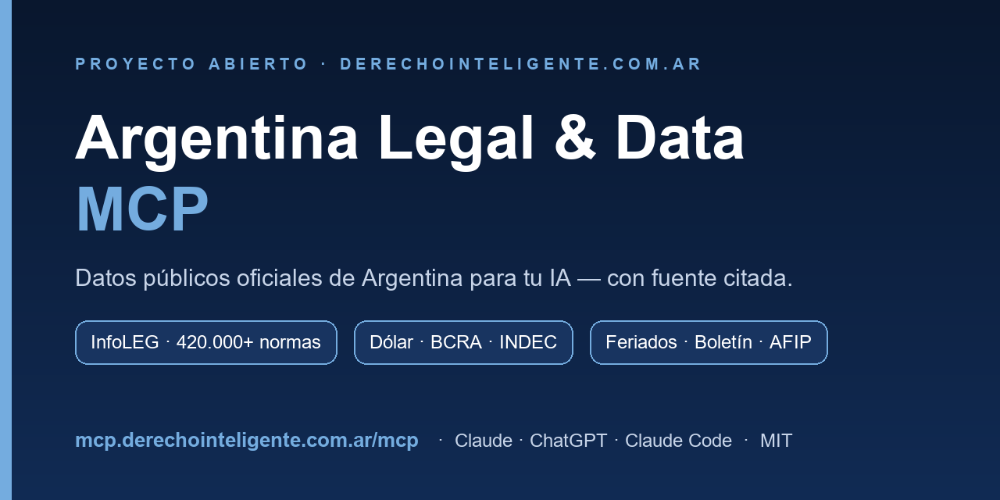

# Argentina Legal & Data MCP



[](LICENSE)


[](https://derechointeligente.com.ar)

> **Un asistente de IA con acceso a los datos públicos oficiales de Argentina.**
> Conectás Claude / ChatGPT a este servidor y te responde con **legislación nacional,
> Boletín Oficial, dólar, BCRA, INDEC, feriados y cálculos de actualización y plazos** — con
> **fuente citada** y sin inventar.

**🌐 En vivo:** `https://mcp.derechointeligente.com.ar/mcp`

---

### Un proyecto abierto de [derechointeligente.com.ar](https://derechointeligente.com.ar)

Publicamos **toda la investigación y el código de forma abierta** para **difundir las
posibilidades que nos da la IA generativa** en el mundo jurídico y de datos públicos en
Argentina. La idea es que cualquier persona —abogado, contador, periodista, desarrollador,
tribunal— pueda **usarlo, aprender de él, instalarlo y mejorarlo**. Si te sirve, conectalo;
si querés, contribuí.

> ⚖️ La información proviene de fuentes oficiales y **no constituye asesoramiento jurídico**.
> Es un **insumo** que verifica y cita; la decisión profesional siempre es humana.

---

## ¿Qué es un "MCP"?

El **Model Context Protocol (MCP)** es el estándar que usan los asistentes de IA (Claude,
ChatGPT) para conectarse con fuentes de datos y herramientas externas. Un servidor MCP es,
en criollo, un **"enchufe" 🔌**: lo conectás una vez y después le preguntás a la IA en
lenguaje natural — ella consulta la fuente sola y te responde con datos reales.

**El problema que resuelve:** un modelo de lenguaje solo **alucina** (te inventa el número
de una ley o una fecha) y **está desactualizado**. Este conector lo ancla a **datos
oficiales verificables**.

## Qué puede hacer — 23 herramientas

Todas son de **solo lectura**. Cada una muestra su límite principal, para que sepas qué esperar.

### ⚖️ Legislación nacional (InfoLEG, ~420.000 normas)

| Herramienta | Qué hace | Límite principal |
|---|---|---|
| `infoleg_buscar_normas` | Busca leyes, decretos, DNU, resoluciones, etc. por texto, tipo, número, año, organismo o fechas de publicación. Entiende referencias ("Ley 20628", "DNU 70/2023") y ordena por relevancia, con prioridad a las normas base. | Por defecto consulta el dataset offline (5 resultados por página). `en_vivo=true` usa el buscador real de InfoLEG y, si falla, degrada al dataset avisando. |
| `infoleg_ver_norma` | Ficha de una norma por su id: organismo, fechas, resumen, observaciones y URLs oficiales. | Necesita el id (lo da la búsqueda). |
| `infoleg_obtener_texto_actualizado` | Texto vigente (consolidado) de una norma. | Se pagina en fragmentos de ~8.000 caracteres. Si InfoLEG no tiene versión consolidada, devuelve el original y lo avisa. |
| `infoleg_obtener_texto_original` | Texto tal como se publicó, sin modificaciones. | No refleja lo vigente. Misma paginación. |
| `infoleg_ver_normas_que_la_modifican` | Qué normas modificaron, derogaron o complementaron a esta (vigencia). | Consulta InfoLEG en vivo. Si no responde, la lista viene vacía con un aviso, y **vacía no significa "ninguna"**. |
| `infoleg_ver_normas_que_modifica` | Qué normas modifica o deroga esta. | Mismo límite que la anterior. |
| `infoleg_comparar_original_actualizado` | Diferencia mecánica entre el texto original y el actualizado. | Es un diff de líneas, no vinculante: la conclusión jurídica exige leer los textos. |
| `infoleg_buscar_organismos` | Encuentra el nombre exacto con que InfoLEG registra un organismo (por nombre o sigla, tolerante a tildes y errores) y cuántas normas tiene. | Solo organismos presentes en el dataset. |
| `tributaria_buscar` | Normas tributarias (ARCA/AFIP, impuestos, aduana) del dataset, con filtros y paginación. | Filtra por organismo y términos impositivos del título: no es exhaustivo. |

Recurso: catálogo de tipos de norma (`infoleg://tipos-norma`) · Prompts guiados:
`auditar_norma`, `comparar_versiones`, `buscar_ley_decreto`.

### 📰 Boletín Oficial

| Herramienta | Qué hace | Límite principal |
|---|---|---|
| `boletin_oficial_sumario` | Qué se publicó en el Boletín Oficial de la Nación un día dado (1ra sección: normas y avisos oficiales; 3ra: contrataciones), con filtro por rubro. Con `jurisdiccion="caba"`, el sumario del Boletín de la Ciudad de Buenos Aires. | No hay edición en fines de semana ni feriados; los días muy cargados pueden venir parciales. La 2da sección (sociedades) **no está disponible**. |
| `boletin_oficial_buscar` | Búsqueda de texto en 1ra y 3ra sección, con rango de fechas y paginación. | Mínimo 3 caracteres; es la búsqueda textual del sitio oficial (no semántica). |
| `boletin_oficial_ver` | Texto completo de un aviso o norma publicado, sin HTML. | Es la versión publicada, no la actualizada (para eso, InfoLEG). No incluye anexos ni imágenes: da el link al PDF. |

### 🧮 Cálculos

| Herramienta | Qué hace | Límite principal |
|---|---|---|
| `calcular_actualizacion` | Actualiza un monto entre dos fechas por **CER, UVA o ICL** (BCRA) o **IPC** nivel general nacional (INDEC). Devuelve coeficiente, monto, valor del índice en cada punta y fuente. | Orientativo: el índice aplicable depende del contrato o la sentencia. **No calcula intereses ni tasas.** |
| `calcular_plazo` | Vencimiento de un plazo en días hábiles (hasta 365) o corridos (hasta 1.100). Descuenta fines de semana, feriados nacionales y feriados puente, y lista los días salteados. | **No contempla** feriados provinciales ni municipales, ferias judiciales, días inhábiles de cada tribunal ni plazo de gracia. |

### 💵 Datos económicos

| Herramienta | Qué hace | Límite principal |
|---|---|---|
| `dolar_cotizaciones` | Cotizaciones de hoy: oficial, blue, MEP, CCL, tarjeta. | Viene de DolarAPI (agregador privado, caché de 5 minutos): es referencia, no cotización oficial. Sin histórico. |
| `bcra_cotizaciones` | Cotizaciones oficiales de divisas del BCRA, del último día o históricas. | Pesos por unidad de moneda extranjera, según el BCRA. |
| `bcra_variables` | Catálogo (~1.600 variables) y series del BCRA: reservas, tasas, base monetaria, CER, UVA, ICL. | Hasta 5.000 valores por pedido. |
| `indec_buscar_series` | Busca el id de una serie de INDEC/datos.gob.ar (IPC, EMAE, salarios…), priorizando las vigentes y nacionales. | Revisá cobertura, frecuencia y último dato antes de elegir. |
| `indec_serie` | Trae los valores de una serie por su id. | Hasta 5.000 observaciones por pedido. |
| `feriados_nacionales` | Feriados nacionales de un año, con su tipo (inamovible, trasladable, puente). | No incluye feriados provinciales ni municipales. |

### 🩺 Diagnóstico

| Herramienta | Qué hace | Límite principal |
|---|---|---|
| `data_health` | Estado del dataset offline (cantidad de normas, fecha de construcción) y de cada fuente externa. | Sin parámetros. Informa el estado de las fuentes, no consultas de usuarios. |

### 🔎 `search` y `fetch` (ChatGPT / deep research)

| Herramienta | Qué hace | Límite principal |
|---|---|---|
| `search` | Búsqueda rápida de legislación por palabras clave o referencia; devuelve `id`, título y URL. | Solo palabras clave: para filtros usá `infoleg_buscar_normas`. |
| `fetch` | Trae la norma por `id`: ficha más texto limpio de HTML (actualizado si existe, si no el original). | Primer fragmento de ~8.000 caracteres; al final indica cómo pedir el resto. |

---

## 🆕 Novedades

- **Boletín Oficial de la Nación.** Sumario por día, búsqueda y texto completo de la 1ra
  sección (legislación y avisos oficiales) y la 3ra (contrataciones). La 2da sección
  (sociedades) queda afuera a propósito: el `robots.txt` del sitio la excluye y lo
  respetamos. También se consulta el Boletín de la Ciudad de Buenos Aires.
- **`calcular_actualizacion`.** Actualiza un monto por CER, UVA o ICL (BCRA) o por IPC
  (INDEC), mostrando el valor de cada índice y su fuente.
- **`calcular_plazo`.** Vencimientos en días hábiles con feriados nacionales, aclarando
  qué no contempla (ferias judiciales, feriados provinciales, días inhábiles de cada tribunal).
- **Mejor ranking.** "impuesto a las ganancias" trae primero la Ley 20.628: las normas base
  (muy modificadas) y las referencias directas ("Ley 20628") van primero.
- **Respuestas más honestas.** Si InfoLEG cambia su formato o no responde, el servidor
  degrada al dataset y lo avisa; no sirve resultados vacíos como si fueran datos.
- **Herramientas consolidadas.** `infoleg_buscar_organismos` busca los organismos reales del
  dataset (el filtro de la búsqueda se llama `organismo`) y el estado del dataset está
  dentro de `data_health`.

---

## 🧪 Casos de uso prácticos (con prompts listos para copiar)

Estos son ejemplos reales pensados para **abogados, contadores, periodistas y tribunales**.
Una vez conectado, le escribís esto tal cual a Claude/ChatGPT.

### Vigencia y derecho aplicable
- *"¿La **Ley 27.551** de alquileres sigue vigente o fue derogada? ¿Por qué norma y desde cuándo?"*
- *"Para la **Ley 20.744 (LCT)** dame la línea de tiempo de modificaciones de 2020 a hoy; necesito saber qué redacción del art. 245 regía en marzo 2023."*
- *"¿Qué normas **modificó** la **Ley 27.742 (Bases)**, con fechas?"*

### Investigación y encuadre normativo
- *"Buscá normas nacionales sobre **'proteccion de datos personales'** y decime cuáles siguen vigentes y cuál es la ley marco actual."*
- *"Tengo un caso de **despido discriminatorio**: ¿qué leyes y decretos nacionales aplican? Dame las normas con id, fecha y un resumen."*
- *"Buscá la **Ley 26.994 (CCyC)** y mostrame su ficha: fecha de sanción, B.O., organismo y cuántas normas la modificaron."*

### Boletín Oficial
- *"¿Qué publicó **hoy el Boletín Oficial** sobre **monotributo**?"*
- *"Mostrame el sumario de la **primera sección** del 02/06/2026 y leé la resolución que más te llame la atención."*
- *"Buscá en el Boletín Oficial las **resoluciones de ARCA** de los últimos 30 días."*

### Texto y comparación de versiones
- *"Traeme el **texto vigente del art. 245 de la LCT** para citarlo en una demanda."*
- *"**Compará** el texto original y el actualizado de la **Ley 24.240** (Consumidor) y decime qué artículos cambiaron."*

### Cómputo de plazos procesales
- *"Me notificaron el **09/06/2026** y tengo **5 días hábiles** para apelar: ¿cuándo vence descontando feriados?"*
- *"¿Cuándo vence un plazo de **10 días hábiles** contado desde el **18/12**?"*
- *"Listame los **feriados nacionales de 2026** para planificar vencimientos y audiencias."*

### Actualización de montos (indemnizaciones, cuotas, deudas, sentencias)
- *"Actualizá por **CER** $500.000 fijados en marzo 2023 hasta hoy."*
- *"Actualizá un alquiler de $400.000 por **ICL** entre dos fechas y mostrame el coeficiente."*
- *"Actualizá una **cuota alimentaria** fijada en enero por **IPC** del INDEC hasta el último mes publicado."*
- *"Dame el **tipo de cambio mayorista del BCRA del 28/04/2026** para calcular una diferencia de cambio."*

### Control de calidad / verificación (relatores, dictámenes)
- *"Te paso las normas citadas en este proyecto: Ley 26.994, Ley 24.240, Ley 27.551, Decreto 70/2023. Para cada una: confirmá que **existe**, número correcto y si el artículo citado **sigue vigente** o fue sustituido. Marcá en rojo lo inexistente o desactualizado."*

### Datos económicos para escritos y liquidaciones
- *"¿A cuánto está el **dólar** hoy (oficial/blue/MEP)? Convertí una condena de **USD 10.000** al oficial."*
- *"Último valor de **reservas** y de la **tasa de política monetaria** del BCRA."*

> 👉 **Más de 40 casos de uso prácticos** (para tributaristas y para abogados/relatores),
> con prompts listos: **[`docs/casos-de-uso.md`](docs/casos-de-uso.md)**. Preguntas
> verificables de prueba en [`EVALS.md`](EVALS.md).

---

## 🔌 Cómo conectarlo

**En claude.ai (5 min, sin clave):** Settings → **Connectors** → *Add custom connector* →
Nombre: `Argentina Legal & Data`, URL: `https://mcp.derechointeligente.com.ar/mcp` (sin
credenciales). Activalo en el chat y dale *Permitir* la primera vez.

**En ChatGPT** (Developer mode / Apps): agregá la misma URL como conector.
**En Claude Code:** `claude mcp add --transport http argentina-legal-data https://mcp.derechointeligente.com.ar/mcp`
**Vía API** (Claude `mcp_servers` / OpenAI Responses `tools:[{type:"mcp"}]`): misma URL.

> Es *authless* (datos públicos, solo lectura) → no requiere login. Para un despliegue
> privado se puede activar API-key (ver `.env.example`).

## 🛠️ Cómo está hecho (y a qué se conecta)

- **Python + FastMCP**, transporte `stdio` (local) y `streamable-http` (remoto, el que está
  publicado), detrás de nginx + HTTPS.
- **Híbrido y a prueba de fallos:** un **dataset oficial offline** (SQLite + FTS5, ~420.000
  normas descargadas de `datos.jus.gob.ar`) es la base robusta; las fuentes en vivo agregan
  frescura. Si una fuente falla, **degrada con elegancia y lo avisa**.
- **Fuentes:** InfoLEG (`servicios.infoleg.gob.ar`), dataset `datos.jus.gob.ar`, BCRA
  (`api.bcra.gob.ar`), INDEC/datos.gob.ar (`apis.datos.gob.ar`), DolarAPI, ArgentinaDatos,
  Boletín Oficial de la Nación y de la Ciudad de Buenos Aires. Todo con **TLS verificado**,
  caché con vencimiento y backoff.
- **Las tools corren fuera del event loop**, con un presupuesto de 25 segundos por consulta:
  una consulta lenta a una fuente no frena a los demás usuarios.
- **Reimplementación clean-room**, bien testeada (155 tests pasan, 1 salteado: PostgreSQL sin
  base real) — ver [`DECISIONS.md`](DECISIONS.md), [`STATUS.md`](STATUS.md), [`NOTICE`](NOTICE).

## 💻 Instalarlo vos mismo (local, con Claude Desktop / Claude Code)

```bash
git clone https://github.com/juanterraf/<este-repo>.git && cd <este-repo>
python -m venv .venv && . .venv/Scripts/activate      # Windows: .venv\Scripts\activate
pip install -e .
python -m arg_legal_mcp build-dataset                 # baja el dataset oficial (ZIP de ~49 MB → SQLite)
python -m arg_legal_mcp                                # corre por stdio
```

## 🚀 Despliegue y mantenimiento de la base

- **La base se actualiza sola:** un timer de systemd
  (`systemd/argentina-legal-data-mcp-dataset.timer`) la reconstruye una vez por semana
  (domingos a las 04:00). También podés hacerlo a mano con
  `python -m arg_legal_mcp build-dataset`.
- **Reconstrucción atómica:** se baja el ZIP oficial por https (~49 MB), se arma la base en un
  archivo temporal con lock y recién al final reemplaza a la vigente. El servidor toma la base
  nueva sin reiniciar. La actualización **no se expone por MCP**: solo por CLI o timer.
- **Deploy al VPS:** con un script local que no se publica (sube lo versionado en `HEAD`, instala
  servicio y timer, ajusta permisos y corta si el servicio no queda activo). No toca nginx ni el dataset.
- Hay `Dockerfile`, `docker-compose.yml`, `systemd/` y `Caddyfile` para otros esquemas;
  más detalle en [`STATUS.md`](STATUS.md).

## ⚠️ Límites y cuidados

- **No es asesoramiento jurídico.** Es un insumo que cita fuentes oficiales; verificá contra
  la fuente antes de cualquier uso profesional o probatorio.
- **Los cálculos son orientativos.** `calcular_actualizacion` y `calcular_plazo` no reemplazan
  la liquidación ni el cómputo procesal: el índice aplicable, los intereses, las ferias judiciales
  y los días inhábiles de cada tribunal dependen del caso y de la norma.
- **Cobertura:** legislación **nacional**. No incluye jurisprudencia, doctrina ni normativa
  provincial. Del Boletín Oficial de la Nación, solo 1ra y 3ra sección.
- **InfoLEG en vivo puede caer.** Cuando pasa, el servidor degrada al dataset offline y lo
  avisa en la respuesta (campo `aviso`). Una lista de vínculos vacía con aviso **no** significa
  que la norma no tenga modificaciones.
- **El texto se pagina** en fragmentos de 8.000 caracteres: si hay más, la respuesta indica
  desde dónde seguir.
- **Datos de terceros:** el dólar viene de un agregador privado (DolarAPI) y sirve como
  referencia. No hay consulta de padrón de ARCA (datos de un CUIT).

## 🔒 Seguridad y privacidad

- Servidor público de **solo lectura**: no expone ninguna acción que modifique datos ni
  dispare procesos en el servidor.
- **Sin datos personales en los logs:** se registra qué herramienta se llamó, cuánto tardó y
  si anduvo, nunca los argumentos ni las consultas. Las consultas de otros usuarios no son
  visibles desde ninguna tool.
- TLS siempre verificado hacia las fuentes, tope de 1 MiB por pedido y respeto del
  `robots.txt` del Boletín Oficial.

## 📄 Atribución, datos y licencia

- Proyecto de **[derechointeligente.com.ar](https://derechointeligente.com.ar)**, publicado
  de forma abierta para difundir el uso responsable de la IA generativa.
- Datos: **InfoLEG** (Ministerio de Justicia) y dataset **datos.jus.gob.ar** (CC BY 2.5 AR),
  BCRA, INDEC/datos.gob.ar, entre otros — ver [`NOTICE`](NOTICE) y [`CREDITS.md`](CREDITS.md).
- Código bajo licencia **MIT**. Contribuciones bienvenidas.
